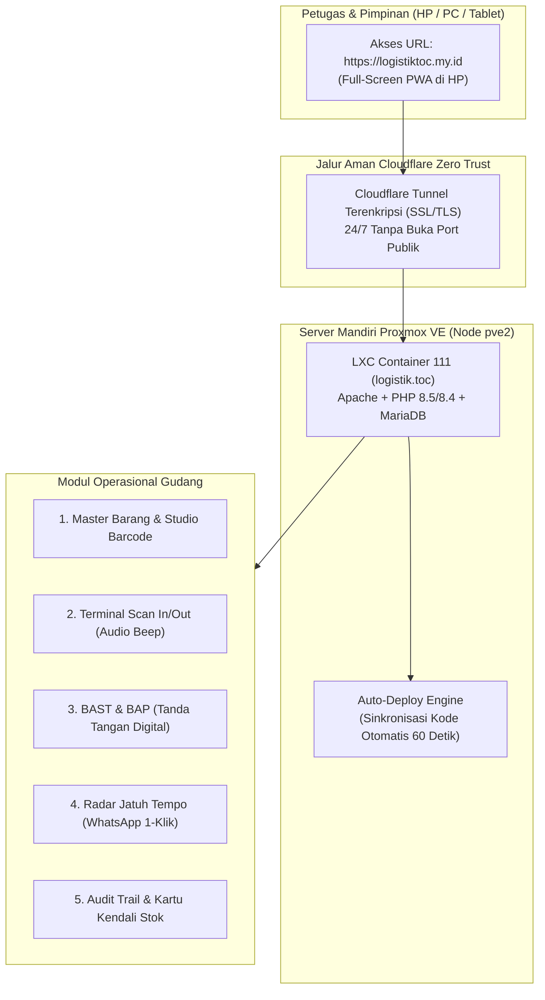

# MODUL PRESENTASI & PANDUAN PENGGUNAAN RESMI
# SISTEM INFORMASI LOGISTIK GUDANG & SCAN BARCODE (LOGISTIK.TOC)

---

## DAFTAR ISI MODUL
1. **Bagian 1: Ringkasan Eksekutif & Paparan Slide Deck Pimpinan**
   - Slide 1: Latar Belakang & Urgensi Digitalisasi
   - Slide 2: Visi & Keunggulan Sistem LOGISTIK.TOC
   - Slide 3: Arsitektur Infrastruktur & Keamanan Mandiri
   - Slide 4: 5 Pilar Kemampuan Utama Aplikasi
   - Slide 5: Dampak Efisiensi & Akuntabilitas Kedinasan
2. **Bagian 2: Panduan Operasional Lapangan (SOP Petugas Gudang)**
   - SOP 1: Akses Sistem & Instalasi Aplikasi di Layar HP (PWA)
   - SOP 2: Pendaftaran Master Barang Baru & Studio Cetak Barcode
   - SOP 3: Operasional Scan Barcode Cepat (Barang Masuk & Keluar)
   - SOP 4: Penerbitan Berita Acara Serah Terima (BAST Pinjam Pakai)
   - SOP 5: Penerbitan Berita Acara Pengembalian (BAP)
   - SOP 6: Penanganan Radar Peringatan Jatuh Tempo & WhatsApp 1-Klik
   - SOP 7: Pencetakan Kartu Kendali Stok Fisik untuk Audit
3. **Bagian 3: Lembar Tanya Jawab Pimpinan (Executive Q&A)**

---

# BAGIAN 1: SLIDE DECK PAPARAN PIMPINAN (EXECUTIVE PRESENTATION)

---

### SLIDE 1: LATAR BELAKANG & MASALAH OPERASIONAL GUDANG
> **"Dari Pencatatan Konvensional Menuju Akuntabilitas Digital Terpadu"**

* **Kondisi Sebelum Ada Sistem:**
  1. *Pencatatan Manual di Buku Kertas:* Rentan hilang, robek, rusak terkena air/debu, dan tulisan sulit dibaca saat pergantian piket.
  2. *Risiko Salah Ambil Barang:* Petugas kesulitan membedakan barang yang memiliki nama atau merek serupa tanpa verifikasi fisik visual.
  3. *Peminjaman Tidak Terpantau:* Barang dinas yang dipinjam operasional seringkali lupa batas waktu pengembaliannya tanpa ada alat pengingat otomatis.
  4. *Sulit Melakukan Audit Stok:* Membutuhkan waktu berhari-hari untuk mencocokkan jumlah fisik dengan catatan riwayat mutasi barang.
* **Solusi Solutif:** Dihadirkan **LOGISTIK.TOC**, aplikasi inventaris berbasis web & mobile yang mengintegrasikan pemindaian barcode, dokumen berita acara resmi kedinasan, dan pemantauan real-time.

---

### SLIDE 2: INFRASTRUKTUR MANDIRI & KEAMANAN TINGKAT TINGGI
> **"Data Kedaulatan Milik Sendiri, Aman, dan Dapat Diakses 24/7 dari Mana Saja"**

* **Server Mandiri (*Private On-Premise Cloud*):**
  - Berjalan di server virtualisasi **Proxmox Virtual Environment 8.4.1 (Node `pve2`)** pada kontainer mandiri **LXC Debian 111**.
  - Database **MariaDB** berada di server fisik milik sendiri, menjamin kerahasiaan dan privasi data logistik dinas.
* **Koneksi Terowongan Aman (*Cloudflare Zero Trust Tunnel*):**
  - Terhubung ke domain resmi **`https://logistiktoc.my.id`** menggunakan koneksi terowongan (*tunnel*).
  - **Bebas Risiko Peretasan:** Server tidak membuka port publik router (No Port Forwarding), terlindungi firewall global Cloudflare dan enkripsi SSL/TLS HTTPS otomatis.
* **Keamanan Pengguna & Sesi:**
  - **Sesi Ketat 15 Menit:** Pengguna otomatis logout jika tidak ada aktivitas selama 15 menit untuk mencegah penyalahgunaan saat perangkat ditinggalkan.
  - **Hak Akses Berjenjang:** Pemisahan wewenang ketat antara Administrator (berhak hapus riwayat, kelola user, backup DB) dan Petugas Staff Lapangan.

---

### SLIDE 3: 5 PILAR FITUR STRATEGIS LOGISTIK.TOC

| Pilar Fitur | Kemampuan Sistem | Manfaat untuk Kedinasan |
| :--- | :--- | :--- |
| **1. Barcode Studio & Scanning Cepat** | Pembuat barcode otomatis (Code128), cetak stiker label thermal/kertas, pemindai kamera HP & scanner USB dengan nada audio *Beep*. | Mengubah proses input manual 5 menit menjadi **2 detik pemindaian instan**. |
| **2. BAST & BAP Digital Sah** | Formulir pinjam pakai dan pengembalian lengkap dengan tanda tangan digital canvas, foto dokumentasi tanpa batas, dan pratinjau thumbnail barang. | Memberikan **kepastian hukum & akuntabilitas** penanggung jawab barang kedinasan. |
| **3. Radar Jatuh Tempo & WA 1-Klik** | Deteksi otomatis BAST yang melewati batas waktu pengembalian dengan alert merah di Dashboard dan pengingat WhatsApp otomatis. | Memastikan **tidak ada aset dinas yang tertahan** atau hilang tanpa kabar. |
| **4. PWA (Mobile Native Experience)** | Web dapat dipasang (*Add to Home Screen*) di Android/iPhone menjadi aplikasi layar penuh tanpa address bar browser. | Sangat ergonomis dan cepat digunakan oleh petugas piket di lorong gudang. |
| **5. Kartu Kendali Stok & Backup 1-Klik** | Cetak Kartu Riwayat Barang (*Stock Ledger*) standar kedinasan dan pencadangan database SQL mandiri untuk Admin. | Siap untuk **pemeriksaan audit internal/eksternal** dan jaminan *disaster recovery*. |

---

### SLIDE 4: DAMPAK & EFISIENSI OPERASIONAL

1. **Efisiensi Waktu Hingga 85%:** Pencatatan keluar-masuk barang, pencetakan barcode, dan pencarian data berlangsung dalam hitungan detik.
2. **Pencegahan Human Error (Nol Kesalahan Ambil):** Tampilan foto fisik resolusi tinggi pada saat memilih barang di BAST/BAP memastikan petugas mengambil barang yang tepat.
3. **Audit Trail Tak Terbantahkan:** Setiap aksi (tambah barang, scan, hapus, unduh dokumen) mencatat nama petugas login, jabatan, alamat IP, waktu WIB presisi, dan koordinat perangkat.
4. **Bebas Biaya Berlangganan (Zero Recurring Cost):** Dibangun dengan teknologi open-source modern (Laravel 12, PHP 8.5/8.4, Tailwind CSS, MariaDB) yang berjalan selamanya tanpa biaya lisensi bulanan.

---

# BAGIAN 2: PANDUAN OPERASIONAL LAPANGAN (SOP PETUGAS)

---

### SOP 1: AKSES SISTEM & CARA MEMASANG APLIKASI DI HP (PWA)
1. Buka browser HP (Google Chrome di Android, atau Safari di iPhone).
2. Masukkan alamat URL: **`https://logistiktoc.my.id`**
3. Masukkan **Username/Email** dan **Password** resmi yang diberikan Administrator.
4. **Memasang Jadi Aplikasi HP:**
   - Di Android (Chrome): Klik tombol menu titik tiga di kanan atas $\rightarrow$ Pilih **"Tambahkan ke Layar Utama" (Add to Home Screen)** atau klik tombol **"Pasang / Install di Layar HP"** pada laci menu samping.
   - Di iPhone (Safari): Klik tombol Share (ikon kotak panah ke atas) $\rightarrow$ Gulir ke bawah dan pilih **"Tambah ke Layar Utama"**.
5. Ikon **LOGISTIK.TOC** kini muncul di menu HP Anda dan dapat dibuka satu klik secara *Full-Screen*.

---

### SOP 2: MENDAFTARKAN BARANG BARU & CETAK STIKER BARCODE
1. Pada menu navigasi sebelah kiri, klik **"Data Barang & Gudang"** (`/items`).
2. Klik tombol hitam **"+ Tambah Barang & Buat Barcode"**.
3. Sistem secara cerdas akan mengisikan **Kode Barang** dan **Nilai Barcode** unik anti-bentrok secara otomatis.
4. Isi data barang:
   - Nama Lengkap Barang (contoh: *Handy Talky Motorola CP1660*).
   - Kategori & Satuan (Unit, Pcs, Box, dll).
   - Merek & Lokasi Penyimpanan Rak (contoh: *Rak A-02 Gudang Utama*).
   - Jumlah Stok Awal & Batas Minimal Peringatan Stok (*Min Stock*).
   - **Upload Foto Fisik Barang:** Pilih foto barang yang jelas dari galeri atau kamera HP.
5. Klik **"Simpan & Daftarkan Barang"**.
6. **Mencetak Stiker Barcode:**
   - Klik tombol **"Cetak Barcode"** atau masuk ke menu **"Studio Pembuat Barcode"**.
   - Pilih ukuran kertas (Stiker Label Satuan, Thermal Roll, atau Kertas HVS A4 Grid).
   - Klik **"Cetak Label Barcode"** untuk ditempelkan pada fisik barang inventaris.

---

### SOP 3: TERMINAL SCAN BARCODE (BARANG MASUK & KELUAR)
1. Buka menu **"Scan Barcode (In/Out)"** (`/scan`).
2. Pilih tab transaksi:
   - **Scan Masuk (Inbound):** Untuk penerimaan barang baru atau kiriman logistik pemasok.
   - **Scan Keluar (Outbound):** Untuk pengeluaran barang operasional dinas.
3. Arahkan kamera HP ke stiker barcode barang (atau gunakan scanner USB barcode fisik):
   - Jika barcode terbaca valid, sistem otomatis berbunyi **"BEEP!"** dua nada merdu dan memunculkan foto barang, lokasi rak, serta stok terkini.
   - Jika barcode salah atau belum terdaftar, sistem akan berbunyi **"BUZZER"** nada peringatan.
4. Masukkan jumlah barang (Qty), nama pengantar/penerima, dan catatan singkat.
5. Klik tombol **"Simpan Hasil Scan ke Database"**. Sisa stok di gudang otomatis terbarui saat itu juga!

---

### SOP 4: MEMBUAT BERITA ACARA SERAH TERIMA (BAST PINJAM PAKAI)
1. Buka menu **"Berita Acara (BAST & BAP)"** $\rightarrow$ Klik **"+ Buat Berita Acara Baru"**.
2. Pilih Jenis Dokumen: **"Berita Acara Serah Terima (BAST)"**.
3. Tentukan Keperluan Dinas, Batas Waktu Pengembalian (*Expected Return Date*), serta data identitas Pihak Pertama (Penyerah) dan Pihak Kedua (Peminjam).
4. **Pilih Barang Pinjaman:**
   - Pada kolom pemilihan barang, klik dropdown.
   - **Verifikasi Visual:** Kotak thumbnail foto fisik barang langsung tampil di sebelah kiri dropdown. Klik foto jika ingin memperbesar (*lightbox zoom*) untuk memeriksa kondisi fisik barang.
   - Di bawah nama barang tampil info real-time: `Stok Gudang • Merek • Lokasi Rak`.
5. **Dokumentasi & Tanda Tangan:**
   - Upload foto bukti penyerahan barang (bisa multi-foto tanpa batas).
   - Pihak Pertama dan Pihak Kedua dapat membubuhkan tanda tangan langsung di layar sentuh HP / iPad (*Digital Signature Canvas*).
6. Klik **"Terbitkan & Simpan Berita Acara (BAST)"**. Dokumen resmi bernomor dinas langsung terbit dan siap diunduh/dicetak dalam format PDF.

---

### SOP 5: MEMBUAT BERITA ACARA PENGEMBALIAN (BAP)
1. Saat barang dinas dikembalikan oleh peminjam, buka menu **"Berita Acara (BAST & BAP)"**.
2. Cari dokumen BAST peminjaman yang bersangkutan $\rightarrow$ Klik tombol hijau **"Buat BAP Kembali"**.
3. Sistem otomatis menyalin seluruh rincian barang, nomor seri, dan identitas peminjam dari BAST sebelumnya.
4. Periksa kondisi fisik barang (Baik, Rusak Ringan, atau Rusak Berat).
5. Kedua belah pihak menandatangani kanvas digital pengesahan pengembalian.
6. Klik **"Terbitkan BAP"**:
   - Status BAST sebelumnya otomatis berubah menjadi **"Sudah Dikembalikan (Returned)"**.
   - Stok barang di gudang otomatis dikembalikan menjadi **"Sedia"**.

---

### SOP 6: PENANGANAN RADAR JATUH TEMPO & PENGINGAT WHATSAPP
1. Buka **Dashboard Analitik** (`/dashboard`).
2. Jika ada peminjam yang terlambat mengembalikan barang, di bagian atas otomatis muncul banner merah berkedip:
   **"Radar Pengingat: X Dokumen BAST Melewati Jatuh Tempo!"**.
3. Petugas cukup menekan tombol hijau **"Ingatkan via WA"**:
   - Sistem secara otomatis membuka aplikasi WhatsApp menuju nomor HP peminjam.
   - Teks pesan resmi kedinasan sudah terisi otomatis berisi rincian nomor BAST, daftar barang yang dibawa, dan jumlah hari keterlambatan.
4. Petugas tinggal menekan tombol kirim di WhatsApp.

---

### SOP 7: MENCETAK KARTU KENDALI STOK (STOCK LEDGER)
1. Buka menu **"Data Barang & Gudang"** (`/items`).
2. Di baris barang yang ingin diaudit, klik tombol biru muda **"Kartu Stok"**.
3. Tampil lembar fisik resmi standar kedinasan dengan KOP Markas Logistik TOC.
4. Lembar ini memuat profil barang, barcode visual, tabel kronologis setiap transaksi masuk, keluar, nomor referensi BAST/BAP, petugas piket yang memindai, dan saldo akhir stok.
5. Klik tombol **"Cetak / Simpan PDF"** untuk dilampirkan dalam berkas pertanggungjawaban audit pimpinan.

---

# BAGIAN 3: LEMBAR TANYA JAWAB PIMPINAN (EXECUTIVE Q&A)

### Q1: Apakah aplikasi ini aman jika HP petugas piket hilang di lapangan?
**Jawaban:**
> Sangat aman. Sistem dilengkapi mekanisme pengaman ganda:
> 1. **Sesi Ketat 15 Menit:** Jika HP tertinggal atau hilang dalam kondisi tidak disentuh selama 15 menit, sistem otomatis mengunci dan mengeluarkan sesi login secara paksa.
> 2. **Manajemen Akun Terpusat:** Administrator logistik dapat menonaktifkan akun petugas yang HP-nya hilang dalam 1 detik melalui menu Setingan Profil, sehingga akses dari perangkat tersebut otomatis tertolak seketika.

### Q2: Bagaimana jika koneksi internet di lapangan sedang lambat atau padam?
**Jawaban:**
> Aplikasi telah dilengkapi teknologi **Progressive Web App (PWA)** dengan file caching lokal di memori HP. Shell antarmuka tetap dapat dimuat dengan cepat. Selain itu, petugas tetap dapat memindai barang menggunakan scanner USB fisik atau kamera internal HP berkecepatan tinggi tanpa hambatan.

### Q3: Bagaimana jika ada barang yang mirip namanya atau barcode fisiknya terkelupas?
**Jawaban:**
> Sistem menyediakan fitur **Pratinjau Foto Fisik Interaktif**:
> - Saat memilih barang di formulir BAST/BAP, foto asli barang langsung muncul di layar dan bisa diperbesar (*zoom*) untuk melihat nomor seri dan model barang.
> - Jika stiker barcode terkelupas, petugas dapat mencetak ulang stiker barcode pengganti hanya dalam 2 klik melalui menu **Studio Pembuat Barcode**.

### Q4: Apakah database aman dari risiko kerusakan server (*Disaster Recovery*)?
**Jawaban:**
> Sangat aman. Di samping backup berkala snapshot server Proxmox, Administrator dapat mengunduh salinan utuh database MariaDB berformat `.sql` murni kapan saja melalui tombol **"Unduh Backup (.SQL)"** di menu Profil untuk disimpan ke komputer atau flashdisk pimpinan.
